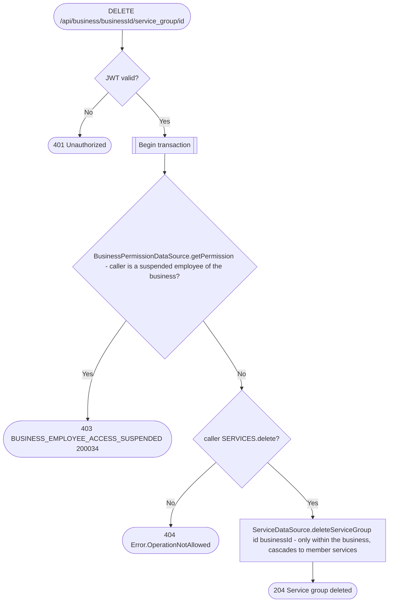

# Delete service group

`DELETE /api/business/{businessId}/service_group/{id}` → `DeleteServiceGroup`

Deletes the group and, per the route's own description, every service that
belongs to it (cascading delete happens at the datasource/table level).

The delete is scoped to the business the permission check ran against
(`WHERE id = ? AND business_id = ?`). A group id of another business matches
nothing and the route still answers 204, exactly like an unknown id, so the
response does not reveal whether that group exists. Before this scoping, a
caller with `SERVICES.delete` in one business could delete any business's
group and, through the cascade, all of its services.

