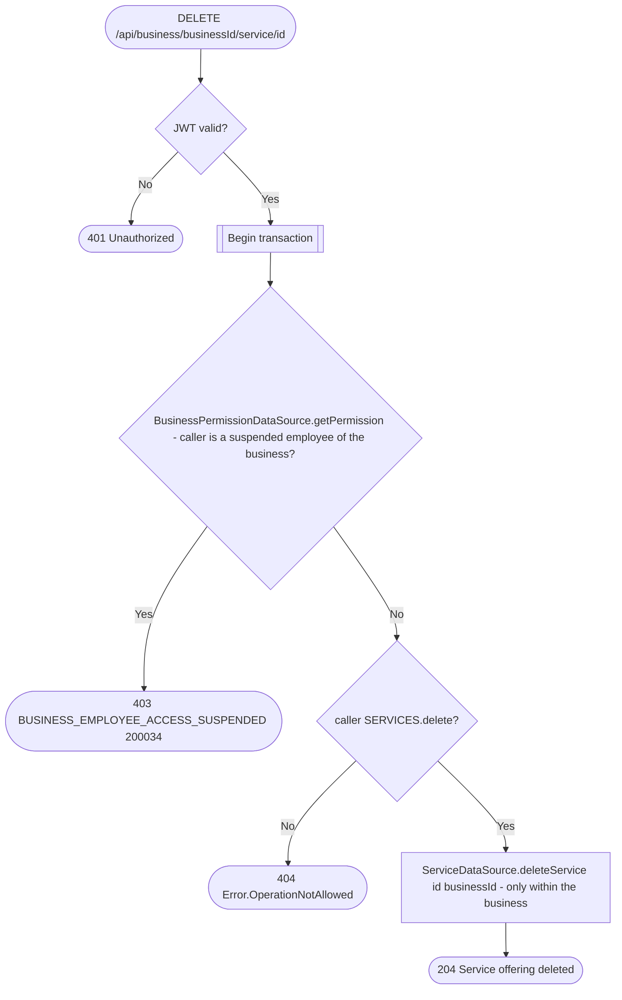

# Delete service

`DELETE /api/business/{businessId}/service/{id}` → `DeleteService`

The delete is scoped to the business the permission check ran against
(`WHERE id = ? AND business_id = ?`). A service id of another business matches
nothing and the route still answers 204, exactly like an unknown id, so the
response does not reveal whether that service exists. Before this scoping, a
caller with `SERVICES.delete` in one business could delete any business's
service by id.

No business row lock is taken: a delete running alongside a currency change
in [`UpdateBusiness`](update-business.md) can only make its `hasServices`
check see one service too many, which keeps the currency locked. It can never
let prices in two currencies coexist.

