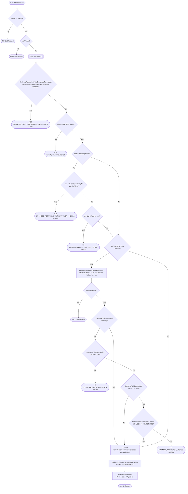

# Update business

`PUT /api/business/{id}` → `UpdateBusiness`

Partial update: every field on `BusinessUpdateModel` is nullable and only
non-null fields are applied. String fields are silently truncated to the
entity's max length rather than rejected, except `currencyCode`, which is
validated. Publishes `BusinessEvent.Updated`
so other services (appointments' business snapshot, in particular) stay in
sync.

The currency is locked once the business has a service: every service price
and every appointment snapshot taken from it is denominated in it, and money
in two currencies cannot be summed. Re-sending the stored currency is a no-op
and always allowed, so clients that send the full model keep working.
`lockBusiness(id, RowLock.EXCLUSIVE)` takes the business row lock
(`SELECT … FOR UPDATE`), which waits for every `CreateService`/`UpdateService`
holding `RowLock.SHARED` (`LOCK IN SHARE MODE`) on the same row. `hasServices`
is itself a locking read (`LOCK IN SHARE MODE`): under REPEATABLE READ a plain
read would use the snapshot fixed by the earlier permission lookup and miss a
service committed while this transaction waited for the lock
(`BusinessRowLockMariaDbTest` reproduces exactly that against MariaDB).

A stored currency that `CurrencyValidator` rejects (written before currency
validation existed, e.g. `usd`) does not lock: its prices cannot be in that
currency, and without this the business could neither price services nor
repair its currency.

**Consumed by:** `BusinessEvent.Updated` → [appointments: refresh the
cached business snapshot](../appointments/on-business-updated.md).
