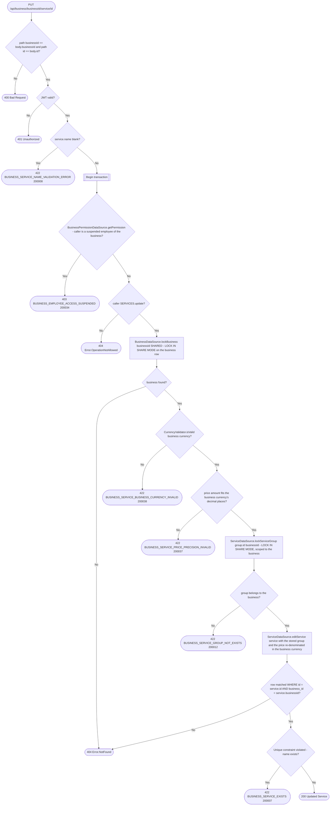

# Update service

`PUT /api/business/{businessId}/service/{id}` → `UpdateService`

The price is always stored in the business currency: the amount from the
body is kept and its currency is replaced by `business.currency`, so every
service of a business shares one currency and quote/appointment totals can be
summed. An amount the business currency cannot represent (`100.50` for a `JPY`
business) is rejected rather than rounded; trailing zeros (`100.00` → `JPY
100`) are fine. The business row is locked with `RowLock.SHARED` (`LOCK IN
SHARE MODE`): service writes do not block each other, but a currency change in
[`UpdateBusiness`](update-business.md) (`RowLock.EXCLUSIVE`) waits for them,
and they wait for it. A stored currency that is not a supported currency
(legacy data such as `usd`) is rejected until the business currency is fixed.

The group is resolved server-side with `lockServiceGroup(group.id,
businessId)`: a group of another business is rejected, and the stored group
replaces whatever group object the client sent, in both the row and the
response. Its shared lock makes a concurrent
[`DeleteServiceGroup`](delete-service-group.md) wait, so the group cannot
disappear between the check and the write.

`editService` matches the row by both its id and the business id the
permission check ran against, so a caller allowed to edit one business's
services cannot rewrite another business's service by id; it also persists
`name`, so a rename that collides with an existing service name now reaches
the unique-constraint branch.

