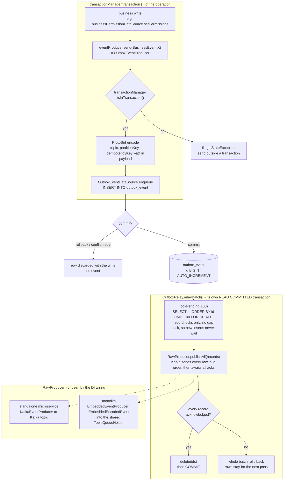
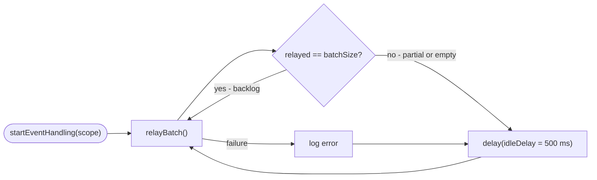
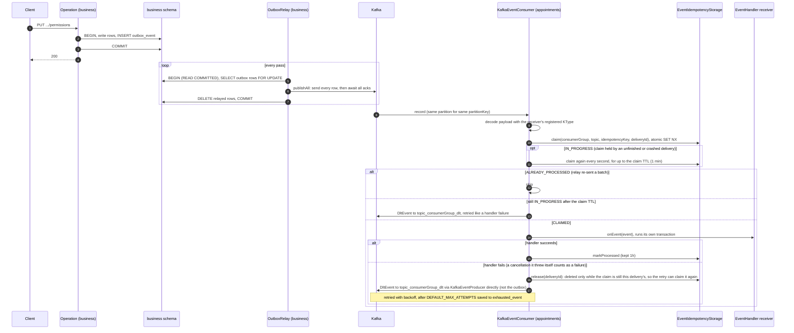
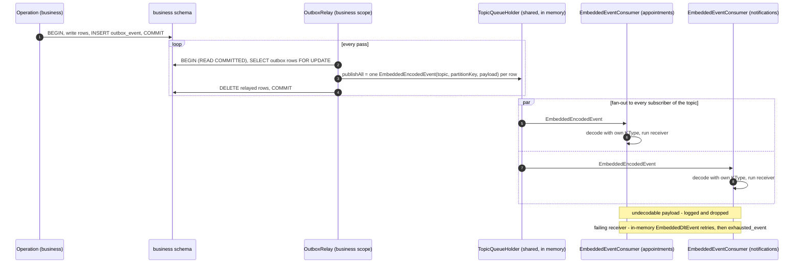

# Transactional outbox

An operation's database write and the event it announces must succeed or
fail together. Kafka can't join a database transaction, so an operation never
talks to Kafka directly: `eventProducer.send` stores the encoded event in the
service's own `outbox_event` table **inside the operation's transaction**,
and a background `OutboxRelay` publishes committed rows afterwards.

- A rolled-back transaction (domain error, crash, or one of the
  `ExposedTransactionManager` conflict retries) rolls back its outbox row too,
  so no event exists for a write that never happened.
- A committed row stays in the outbox until the relay has handed it to the
  transport, so an unreachable broker delays the event instead of losing it.
- Delivery is **at-least-once**: a relay that publishes and then fails before
  committing its delete publishes the batch again on the next pass.

Code: `core/data/eventstreaming/data` (`OutboxEventProducer`, `OutboxRelay`,
`OutboxEventDataSourceImpl`, `OutboxEventTable`, `outboxModule`) and
`core/data/eventstreaming/impl` (transports). Schema: `OUTBOX_EVENT` in
[business](database/business.md).

**Rollout status:** business sends through the outbox. Auth, user,
appointments and notifications still send to the transport directly
(`eventStreamingModule` / `embeddedEventStreamingModule`).

## Overview

The write side is identical in both deployments. Only the transport the
relay hands rows to differs.

### Relay loop

`OutboxRelay` is registered as an `EventHandler`, so `startEventHandling(scope)`
starts one relay per service scope, both in a standalone microservice and in
the monolith.

## Standalone microservice (Kafka)

Wiring: `eventStreamingTransportModule(Scope, SERVICE_NAME)` +
`outboxModule(Scope)`.

## Monolith (embedded)

Wiring: `embeddedEventStreamingTransportModule(Scope, SERVICE_NAME)` + `outboxModule(Scope)`
per service, plus one root `topicQueueHolderModule()`. Every service keeps its
own schema, its own `outbox_event` table and its own relay. Only the in-memory
`TopicQueueHolder` is shared.

## What happens when something fails

| Failure | Outcome |
|---|---|
| Operation throws or its transaction rolls back | The outbox row rolls back with the write. No event. |
| `ExposedTransactionManager` retries a conflicting block | Only the attempt that commits leaves a row, so retries don't multiply events. |
| `send` called outside a transaction | `IllegalStateException`. The event is never stored. |
| Broker unreachable, or `publish` throws | The relay's batch rolls back and the rows stay. Retried after `idleDelay`. Business writes keep inserting outbox rows meanwhile: the relay runs at READ COMMITTED, so its `FOR UPDATE` takes no gap lock (`OutboxRelayMariaDbTest`). |
| Crash after publish, before the delete commits | The batch is published again. Kafka and embedded consumers skip it through `EventIdempotencyStorage` (same `idempotencyKey`, keyed per consumer group, so every consuming service still handles it once). |
| Consumer crashes mid-handler | Its claim stays for up to 1 minute. A redelivery in that window waits for it (re-claiming every second), then handles the event once the claim expires. Only a claim still held after the TTL sends the event through the DLT retries. A handler is expected to finish within the claim TTL. |
| Handler outlives its claim, then fails | Another delivery may already have claimed the event (or finished it). The late `release` is a compare-and-delete on its own `deliveryId` (`CacheClient.deleteIfEquals`, a Lua script on Redis), so it frees neither the other delivery's claim nor the processed marker, and a later duplicate is still skipped. The event itself can be handled twice in this case: the slow handler and the one that took over both ran. |
| Idempotency store (Redis) unreachable | A failed claim is retried through the DLT like a handler failure. A failed `markProcessed` is logged only: the handler already succeeded and is not run again. |
| Two relays for the same schema | The second relay's `FOR UPDATE` waits for the first to commit, then finds the rows deleted. Each row is published once, in id order (`OutboxRelayMariaDbTest`). |
| Consumer can't decode a payload | Logged and dropped, as with Kafka. Later events keep flowing. |
| Receiver keeps failing | DLT retries with backoff, then `exhausted_event`. Consumer-side DLT sends go to the transport directly, never through the outbox. Each consumer group has its own DLT topic (`<topic>_<consumerGroup>_dlt`), so a service retries only its own failures. |
| Monolith process dies | Rows still in `outbox_event` survive and are relayed on restart. Events already handed to the in-memory queue but not yet consumed are lost. |

## Ordering

Rows leave the relay in `id` order. Two writes to the same aggregate are
serialized by its row lock, so the later one inserts (and commits) its outbox
row after the earlier one. A higher id from another aggregate can commit
before a lower one. The relay never tracks a "last sent id"; each pass takes
every pending row, so a late-committing lower id is still picked up. Kafka
then keeps per-`partitionKey` order within a partition.
